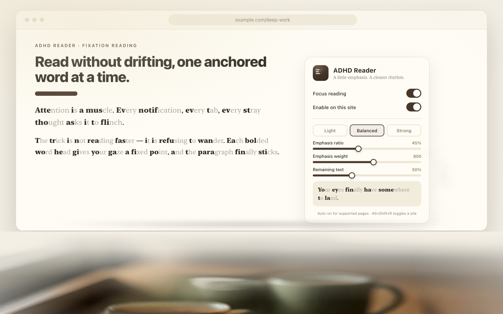

<h1 align="center"> ADHD Reader</h1>
<h3 align="center">
  A Chrome extension for focused reading on any website. It bolds the opening letters of every word, so your eyes have somewhere to land.
</h3>

  
  
  
  

## Why ADHD Reader?

- **Auto-on everywhere:** works on supported pages the moment you install it — no per-page clicks, no reader-mode shell.
- **Native PDF text view:** Chrome 151+ MIME-handler integration, powered by a bundled pdf.js that never leaves your machine.
- **Local-only:** in-place text transformation that restores the original page — and your edits — when disabled.
- **Zero telemetry:** no accounts, no server, no analytics, no remote code.

## How it works

Supported pages get emphasis automatically — no per-page clicks, no reader-mode shell. The original page layout, images, and code blocks are untouched; only word beginnings are bolded. Use the toolbar popup for Light / Balanced / Strong presets and fine-grained sliders, or press `Alt+Shift+R` to toggle the current site.

## Installation

### Chrome Web Store

Listing is pending review. Link will appear here once published.

### From source

1. Clone this repository
2. Open `chrome://extensions`, enable **Developer mode**
3. Click **Load unpacked** and select the repository directory
4. Reload existing tabs after installing or updating

## Features

- Automatic emphasis on supported sites; nothing to click per page
- Light / Balanced / Strong presets, plus ratio (20–70%), weight (500–900), and remaining-text opacity (40–100%)
- Live sentence preview — drag a slider, watch the page change, release to save
- Per-site on/off (`Alt+Shift+R`) and a managed disabled-sites list
- In-place text transformation: inputs, code, editable regions, and graphics are skipped; disabling restores the page while preserving edits
- Incremental idle-time processing for dynamic pages — no jank on heavy sites
- PDF text reading view via a bundled, fully local pdf.js (Chrome 151+ MIME-handler integration)
- Google Docs "Focus Reader" panel for canvas-rendered documents
- Unicode grapheme clusters and RTL supported; CJK scripts are intentionally left unchanged
- No accounts, no server, no analytics, no remote code

## Comparison

| | ADHD Reader | [Jiffy Reader](https://github.com/ansh/jiffyreader-public-archive) | [Hyper Bold](https://chromewebstore.google.com/detail/hyper-bold/bjicoipahmlimcmjoejgaoneibennoab) | [Bionic Reading®](https://bionic-reading.com/) |
|---|:---:|:---:|:---:|:---:|
| Free | ✅ | ✅ | ✅ | 💰 paid |
| Open source | ✅ | ⚠️ archived 2025 | ❌ | ❌ |
| Automatic on every page | ✅ | ✅ | ✅ | ❌ per-page clicks |
| PDF text view | ✅ native MIME handler | ✅ | ❌ | ❌ |
| Google Docs panel | ✅ | ❌ | ❌ | ❌ |
| CJK scripts left unchanged | ✅ | ❌ | ❌ | ➖ |
| Restores page on disable | ✅ | ⚠️ | ⚠️ | n/a (reader shell) |
| Zero accounts / server / telemetry | ✅ | ✅ | ❓ closed | ❓ closed |

*Bionic Reading® is a registered trademark of its respective owner; this project is independent and uses no trademarked terms in code or listings.*

## Settings

Open the toolbar popup on any page:

| Control | Effect |
|---|---|
| Focus reading | Global on/off |
| Enable on this site | Per-site toggle (same as `Alt+Shift+R`) |
| Light / Balanced / Strong | Starting points for the sliders |
| Emphasis ratio | How much of each word is bolded |
| Emphasis weight | Bold stroke weight (500–900) |
| Remaining text | Opacity of the un-bolded part |

Sliders preview on the active page while dragging and save on release. Preferences sync through your browser profile.

## PDF reading view

Chrome's built-in PDF viewer cannot be restyled by extensions, so ADHD Reader ships its own local text view powered by pdf.js 5.4.149 (bundled under `vendor/pdfjs/`, Apache-2.0). On Chrome 151+ the `application/pdf` MIME handler keeps the original URL in the address bar and supports embedded PDFs; a viewer button hands the stream back to Chrome's native viewer. The popup also offers **Open in ADHD Reader** for PDF URLs and local files (the local file picker needs no file-access switch). This is a text view: layout and images may differ, and scanned PDFs without a text layer cannot be emphasized.

## Google Docs

Docs renders text to canvas, so in-place bolding is not possible. On `docs.google.com/document/*` a floating **Focus Reader** button opens a panel that formats extracted or pasted text with your live settings. The extension never edits the document.

## Privacy

No accounts, no server, no analytics, no remote code. Page text is processed locally and never uploaded. PDFs are parsed by the bundled pdf.js on your machine. See [PRIVACY.md](PRIVACY.md).

## Limitations & FAQ

- **Which pages are not processed?** Chrome internal pages, the Chrome Web Store, protected pages, and text nodes over 4,000 UTF-16 units. Shadow DOM and cross-origin iframes are skipped in v0.2.
- **Chinese / Japanese / Korean?** Intentionally unchanged — letter-by-letter emphasis does not apply to logographic scripts.
- **A specific site looks wrong?** Toggle it off with `Alt+Shift+R`; complex apps sometimes need a site opt-out.
- **Why is my review taking long?** Broad host permissions (`<all_urls>` is required to work on any page) trigger Chrome Web Store's in-depth review.

## Development

No build dependencies. Regenerate icons with `node scripts/make-icons.js`, syntax-check with `node --check`, run behavioral checks with `node scripts/check.js` (Node 20+), and package with `bash scripts/build.sh` → `dist/adhd-reader.zip`.

To refresh the bundled pdf.js: `npm pack pdfjs-dist@5.4.149`, then copy `build/pdf.min.mjs`, `build/pdf.worker.min.mjs`, and `LICENSE` into `vendor/pdfjs/`. Keep library and worker versions identical.

## Alternatives

This space has several options worth knowing:

- [Jiffy Reader](https://github.com/ansh/jiffyreader-public-archive) — pioneered free bionic-style reading; the original repository was archived in 2025.
- [Hyper Bold](https://chromewebstore.google.com/detail/hyper-bold/bjicoipahmlimcmjoejgaoneibennoab) — a lightweight closed-source alternative.
- [Bionic Reading®](https://bionic-reading.com/) — the trademarked original; paid.

If ADHD Reader isn't for you, one of these might be.

## License

[MIT](LICENSE) — the bundled pdf.js is Apache-2.0 (see `vendor/pdfjs/LICENSE`).
